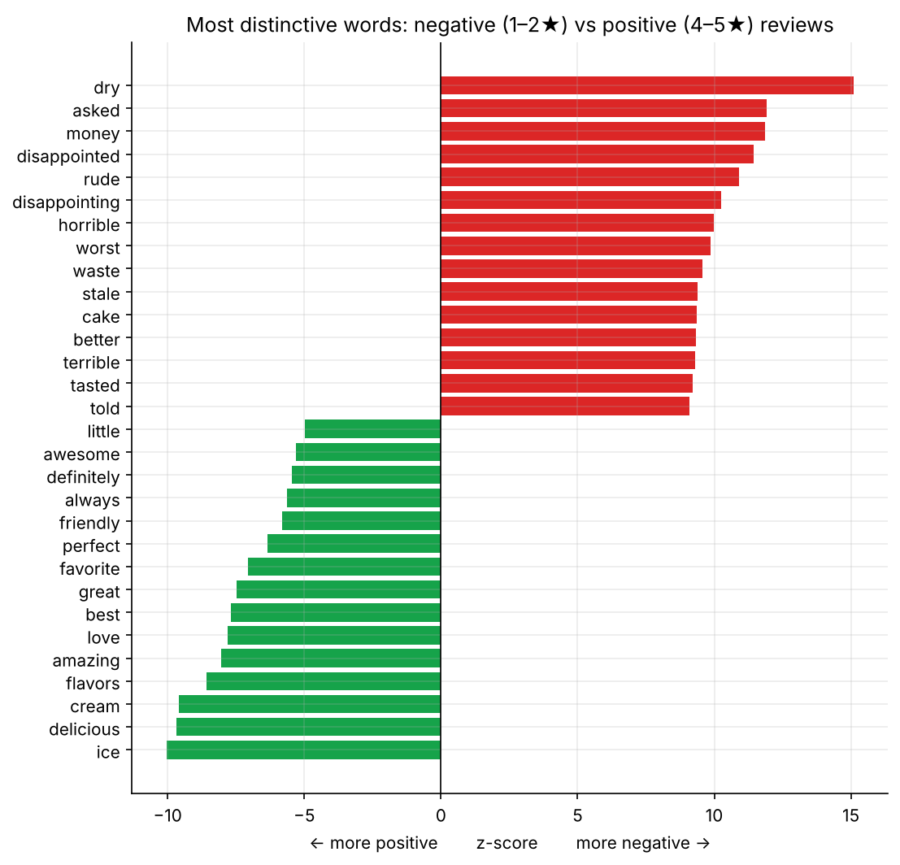
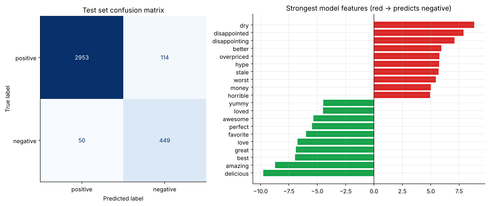

# What Makes a Yelp Review Negative?

A text analysis of about 20,000 Yelp reviews of 49 bakeries and dessert shops, 2005–2022. Star ratings tell you *whether* customers were happy; this project uses the review text to find out *why*. It combines word statistics, phrase (trigram) analysis and a machine learning classifier.

**[Open the full notebook →](yelp_text_analysis.ipynb)**



## Key findings

- **Unhappy customers write more.** The median 2★ review is 87 words, against 57 for a 5★ review.
- **Negative reviews are about product quality, value and staff.** Top negative words include *dry*, *stale*, *money*, *waste* and *rude*, plus *asked* and *told*, which point to bad interactions with staff.
- **Phrases reveal broken expectations.** "Wanted to like", "was so disappointed" and "not worth the" mark negative reviews. "Will definitely be back" and "to die for" mark positive ones.
- **A simple model catches 90% of negative reviews** with 80% precision (ROC AUC 0.98), and the words it relies on match the statistical analysis.



## Methods

| Step | Technique |
|---|---|
| Tokenizing | Lowercased regex tokens, with a custom stopword list |
| Distinctive words | Weighted log-odds ratio with an informative Dirichlet prior (Monroe, Colaresi & Quinn, 2008), so rare words don't dominate |
| Phrases | Trigram counts, scored by an add-one smoothed rate ratio between negative and positive reviews |
| Classifier | TF-IDF (words and two-word phrases) with logistic regression and balanced class weights; stratified 80/20 split; reported with precision, recall and ROC AUC because the classes are imbalanced (14% negative) |
| Error analysis | Inspected the most confident misclassifications |

## Run it

The raw review text is not included in this repo: it belongs to Yelp and the reviewers. To reproduce the analysis, place a CSV with the columns `url, rating, date, review` at `data/yelp_reviews.csv`. I used a sample provided in Emory's QTM 151 course materials; Yelp also publishes an [open dataset](https://www.yelp.com/dataset) for academic use. The executed notebook in this repo shows all the outputs.

```bash
pip install pandas numpy matplotlib scikit-learn jupyter
jupyter notebook yelp_text_analysis.ipynb
```

## Credit

I first worked with this data in Emory University's QTM 151 (Introduction to Statistical Computing II). The questions and analysis here are my own, separate from any course assignment.
